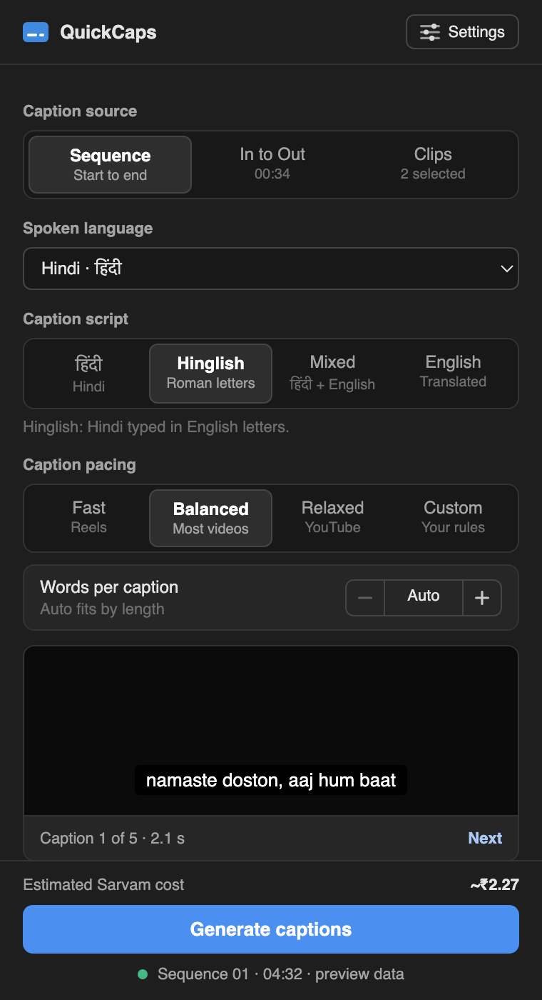
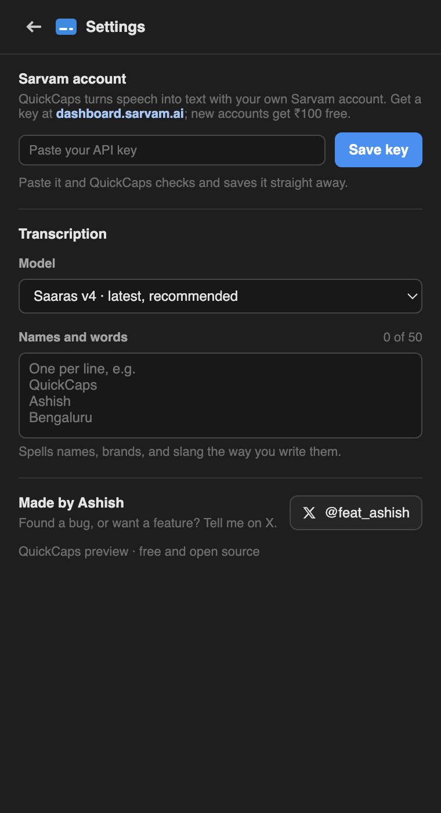

# QuickCaps

**Captions in Hindi, Hinglish, English, and 20 more Indian languages, right inside Adobe Premiere Pro. Free.**

Pick your audio, click **Generate captions**, and get captions timed to the
speech. Fix anything you like, then add them to your timeline. Powered by
[Sarvam AI](https://www.sarvam.ai/), which is built for Indian languages and
for the way we actually mix them.

[**Download**](https://github.com/dedkul/quickcaps-adobe-plugin/releases/latest) ·
[Follow @feat_ashish on X](https://x.com/feat_ashish) for updates and new features

  
  &nbsp;
  
  &nbsp;
  

## What it does

- **23 languages.** Hindi, English, Marathi, Bengali, Gujarati, Tamil, Telugu,
  Kannada, Malayalam, Punjabi, Odia, and 12 more. Or let it detect the language.
- **Four ways to write them.** The language's own script (हिंदी), Roman
  letters (Hinglish, Tanglish), Mixed ("मेरा phone number है"), or English
  subtitles.
- **Any part of your edit.** The whole sequence, your In to Out range, or
  just the clips you select. Captions land exactly where the speech is.
- **Your pace.** Fast for Reels, Relaxed for YouTube, or your own rules,
  down to how many words show at once.
- **Review before you place.** Edit any line, split, merge, delete, and find
  and replace across every caption.
- **Free clean-up.** Remove "umm" and "uh", bleep swear words, Reels style
  (no full stops, optional ALL CAPS), and numbers as digits ("चार हज़ार पांच
  सौ" becomes 4,500).
- **English track.** Add English subtitles as a second track.
- **Never lose work.** Your review is saved as you go. Export an `.srt` file
  or a plain-text transcript for your YouTube description.

## Install

Download from the
[latest release](https://github.com/dedkul/quickcaps-adobe-plugin/releases/latest).
Both files work on Mac and Windows. Most people want the first one.

| File | Premiere Pro | How to install |
| ---- | ------------ | -------------- |
| [QuickCaps-Premiere-2022-2026.zxp](https://github.com/dedkul/quickcaps-adobe-plugin/releases/latest/download/QuickCaps-Premiere-2022-2026.zxp) **(recommended)** | 2022 to 2026 | Install it with the free [ZXP Installer](https://aescripts.com/learn/zxp-installer/). Open **Window → Extensions → QuickCaps**. Captions go straight onto your timeline. |
| [QuickCaps-Premiere-2026.ccx](https://github.com/dedkul/quickcaps-adobe-plugin/releases/latest/download/QuickCaps-Premiere-2026.ccx) (optional) | 2026 only | Adobe's newer plugin format. Double-click it and Creative Cloud installs it. Open **Window → UXP Plugins → QuickCaps**. You drag the captions onto the timeline yourself. |

When a new version comes out, QuickCaps shows a small note at the top of the
panel with a download link.

## Get your Sarvam API key (one time, about 2 minutes)

QuickCaps doesn't listen to your audio itself. Sarvam AI does that, and an
**API key** is how QuickCaps uses your Sarvam account. Think of it as a
password made for apps: you paste it into QuickCaps once, and QuickCaps uses
it every time you make captions. Sarvam bills your account directly, so
QuickCaps never sees your money or your login.

1. Go to [dashboard.sarvam.ai](https://dashboard.sarvam.ai) and sign up. New
   accounts get ₹100 of free credit, about three hours of captions.
2. In the dashboard, find the **API keys** section and create a key.
3. Copy the key. It's a long line of letters and numbers.
4. In QuickCaps, click **Settings** and paste the key. QuickCaps checks it
   with Sarvam and saves it straight away; **Connected** means you're set.

**Keep your key private.**

- Don't share it, and don't post it in a screenshot, video, or tutorial.
  Anyone with your key can use your Sarvam credit.
- If it ever gets out, delete it in the Sarvam dashboard and create a new one.
- QuickCaps keeps the key on your computer, shows only its last four
  characters, and sends it only to Sarvam. **Remove** in Settings deletes it
  from your computer.

## Make captions

1. Open your sequence in Premiere.
2. In QuickCaps, choose the **caption source**, the **spoken language**, and
   the **caption script**. The preview shows how your captions will break.
3. Click **Generate captions** and wait a moment.
4. Check the captions on the review screen and fix anything you like.
5. Click **Add to timeline**. With the optional 2026 .ccx the button says
   **Add to project**: drag the new caption item to the very start of your
   timeline (00:00) and it lines up with the speech.
6. To change the font, size, or colour, select a caption and use
   **Properties → Track Style**.

## What it costs

QuickCaps is free and open source. Sarvam charges your own account ₹30 per
hour of audio, by the second:

| Video | Sarvam cost |
| ----- | ----------- |
| 60-second Reel | ₹0.50 |
| 10-minute vlog | ₹5 |
| 1-hour podcast | ₹30 |

The panel shows the cost before you click Generate. The English track doubles
it; everything else is free. Your audio goes from your computer straight to
Sarvam. QuickCaps has no server and collects nothing.

## Troubleshooting

**The panel is blank after installing the .zxp.** A known Adobe issue with
some installers. Run this, then restart Premiere (use `12` instead of `11`
for Premiere 2025 and later):

- Mac, in Terminal: `defaults write com.adobe.CSXS.11 PlayerDebugMode 1`
- Windows, in Command Prompt: `reg add HKCU\Software\Adobe\CSXS.11 /v PlayerDebugMode /t REG_SZ /d 1 /f`

**"Sarvam rejected the API key."** Copy the key again from
dashboard.sarvam.ai. QuickCaps only works with Sarvam keys, not OpenAI,
Gemini, or other AI keys.

**"Your Sarvam credit has run out."** Add credit in the Sarvam dashboard,
then try again.

**The captions aren't on my timeline (2026 .ccx).** Adobe's newer plugin
format can't create caption tracks yet. The captions are in your Project
panel, already timed: drag them to the start (00:00) of the timeline. Or
install the .zxp instead, which places them for you.

Something else, or an idea for a feature? Message
[@feat_ashish on X](https://x.com/feat_ashish) with a screenshot.

---

## For developers

Project layout, building, and releasing

### Project layout

- `core/`: everything that doesn't touch Premiere directly. The panel UI,
  the Sarvam client, languages, caption building, editing, clean-up, and the
  update check. Shared by both versions.
- `hosts/uxp/`: Premiere Pro 2026 (25.6 and later), using Adobe's UXP API.
- `hosts/cep/`: the .zxp for Premiere Pro 2022 to 2026 (CEP and ExtendScript).
- `presets/`: the audio export preset (WAV, mono, 16 kHz).
- `scripts/`: build, local install, and packaging.
- `screenshots/`: the images in this README.
- `tests/`: run `node tests/core.test.js`.

### Build and load (Premiere 2026)

Install the UXP Developer Tool from the Creative Cloud app, and in Premiere
turn on **Settings → Plugins → Developer mode**. Then run
`node scripts/build.js uxp`, and in the UXP Developer Tool choose
**Add Plugin** → `dist/uxp` → **Load**. After a code change, build again,
then **Unload** and **Load**.

The plugin ID is `com.quickcaps.panel`. Don't change it, or installed copies
won't update.

### Build and load (the .zxp, Premiere 2022 to 2026)

`bash scripts/install-cep-dev.sh` links `dist/cep` into Adobe's extensions
folder and turns on debug mode so Premiere loads the unsigned panel. Undo it
with `bash scripts/install-cep-dev.sh --remove`.

### How it works

- Audio is exported from Premiere, cut into 28-second parts (Sarvam's limit
  is 30), sent three at a time, and retried on rate limits.
- Each caption script is a Sarvam mode: own script = `transcribe`, Roman =
  `translit`, Mixed = `codemix`, English = `translate`. English audio is
  simply transcribed.
- Sarvam times phrases, not words, so word timings inside a phrase are
  estimated from word length.
- Captions are timed to the sequence, so the caption file always belongs at
  00:00. In the .zxp, ExtendScript's `createCaptionTrack` places it
  automatically; in the .ccx it's imported for the user to drag in.
- The update check asks GitHub for the latest release at most once a day.
- The browser preview: run `python3 -m http.server 8642` and open
  `http://localhost:8642/core/ui/index.html` (mock data). Add `?update=demo`
  to see the update note.

### Releasing

1. Bump the version in `hosts/uxp/manifest.json` and
   `hosts/cep/CSXS/manifest.xml`.
2. `bash scripts/package.sh` builds and signs
   `release/QuickCaps-Premiere-2022-2026.zxp`. It needs Adobe's
   `ZXPSignCmd` in `tools/` and the certificate in `signing/`, both kept out
   of git. **Always sign with the same certificate.**
3. `node scripts/build.js uxp`, then in the UXP Developer Tool: ••• on
   QuickCaps → **Package**. Rename the file to `QuickCaps-Premiere-2026.ccx`.
4. On GitHub, create a release tagged `v<version>` and attach both files with
   exactly those names. The download links always point to the latest
   release, and the panel's update note picks it up within a day.

## License

MIT. See [LICENSE](LICENSE). Not affiliated with Adobe or Sarvam AI.
