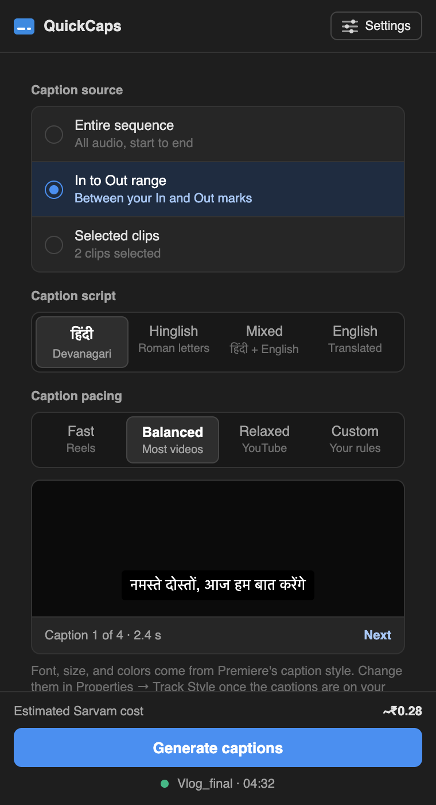
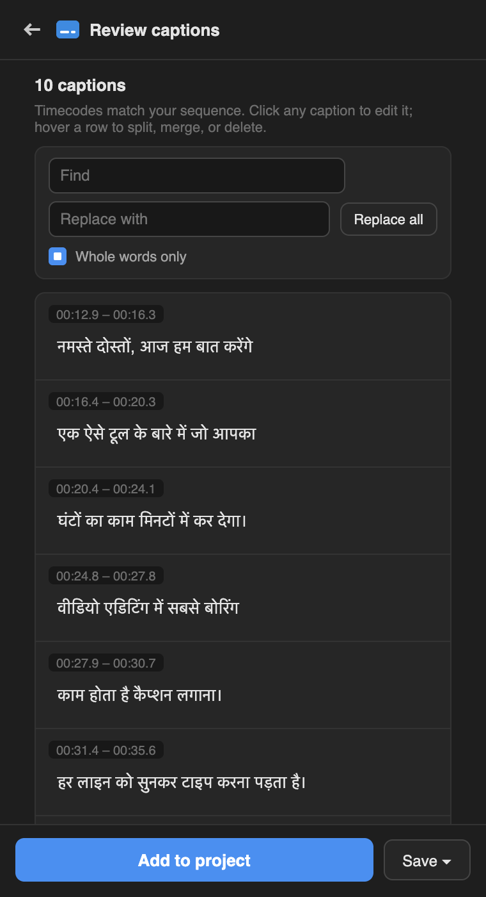

# QuickCaps

**Hindi, Hinglish, and English captions inside Adobe Premiere Pro. Free.**

Pick your audio, click Generate, and get captions timed to the speech. Fix
anything on the review screen, then add them to your timeline. Powered by
[Sarvam AI](https://www.sarvam.ai/), built for Indian languages and
Hindi-English mixing.

[**Download**](https://github.com/dedkul/quickcaps-adobe-plugin/releases/latest) ·
[Website](https://dedkul.github.io/quickcaps-adobe-plugin/) ·
[Report a problem](https://github.com/dedkul/quickcaps-adobe-plugin/issues)

<p>
  
  &nbsp;
  
</p>

## Install

Get the file for your Premiere version from the
[latest release](https://github.com/dedkul/quickcaps-adobe-plugin/releases/latest).
Both work on Mac and Windows.

| Premiere Pro | Download | How to install |
| ------------ | -------- | -------------- |
| 2026 | [QuickCaps-Premiere-2026.ccx](https://github.com/dedkul/quickcaps-adobe-plugin/releases/latest/download/QuickCaps-Premiere-2026.ccx) | Double-click it and Creative Cloud installs it. Open **Window → UXP Plugins → QuickCaps**. |
| 2022 to 2025 | [QuickCaps-Premiere-2022-2025.zxp](https://github.com/dedkul/quickcaps-adobe-plugin/releases/latest/download/QuickCaps-Premiere-2022-2025.zxp) | Install with the free [ZXP Installer](https://aescripts.com/learn/zxp-installer/). Open **Window → Extensions → QuickCaps**. |

Then:

1. Create a Sarvam API key at [dashboard.sarvam.ai](https://dashboard.sarvam.ai).
   New accounts get ₹100 of free credit, about three hours of captions.
2. In QuickCaps, click **Settings**, paste the key, and click **Check key**.
3. Open a sequence and click **Generate captions**.

## What it costs

The plugin is free and open source. Transcription is billed by Sarvam to your
own account at ₹30 per hour of audio, by the second:

| Video | Sarvam cost |
| ----- | ----------- |
| 60-second Reel | ₹0.50 |
| 10-minute vlog | ₹5 |
| 1-hour podcast | ₹30 |

Adding the English track doubles it. Every other option is free. Your audio
goes from your computer straight to Sarvam; QuickCaps has no server and
collects nothing.

## Features

- Four caption scripts: हिंदी, Hinglish (Roman letters), Mixed ("मेरा phone
  number है"), or English subtitles.
- Whole sequence, In to Out, or selected clips, timed to sequence timecode.
- Caption pace presets (Fast for Reels, Relaxed for YouTube) or custom.
- Your names and words, sent to Sarvam so they're spelled your way.
- Review screen with editing, split, merge, and find and replace.
- Optional clean-up: remove fillers, bleep swearing, Reels style, ALL CAPS.
- Optional English track alongside Hindi (doubles the Sarvam cost).
- Saves your review as you go; save as `.srt` or a plain-text transcript.

## Troubleshooting

**The panel is blank after installing (Premiere 2022 to 2025).** A known Adobe
issue with some installers. Run this, then restart Premiere (use `12`
instead of `11` for Premiere 2025):

- Mac, in Terminal: `defaults write com.adobe.CSXS.11 PlayerDebugMode 1`
- Windows, in Command Prompt: `reg add HKCU\Software\Adobe\CSXS.11 /v PlayerDebugMode /t REG_SZ /d 1 /f`

**"Sarvam rejected the API key."** Copy the key again from
dashboard.sarvam.ai. QuickCaps only works with Sarvam keys, not OpenAI,
Gemini, or other AI keys.

**Captions on Premiere 2026 aren't on the timeline.** Premiere 2026's plugin
system can't create caption tracks yet. The captions are in your Project
panel, already timed: drag them to the start (00:00) of the timeline.

Something else? [Open an issue](https://github.com/dedkul/quickcaps-adobe-plugin/issues)
with a screenshot.

---

## For developers

### Project layout

- `core/`: everything that doesn't touch Premiere directly. The panel UI, the
  Sarvam client, caption building, editing, and clean-up. Shared by both hosts.
- `hosts/uxp/`: the adapter for Premiere Pro 2026 (25.6 and later), using
  Adobe's UXP plugin API.
- `hosts/cep/`: the build for Premiere Pro 2022 to 2025 (CEP + ExtendScript).
- `presets/`: the audio export preset (WAV, mono, 16 kHz).
- `scripts/`: build, local install, and packaging.
- `docs/`: the website (GitHub Pages). `promo.html` is a 16:9 promo loop.
- `tests/`: `node tests/core.test.js`.

### Build and load (Premiere 2026)

Install the UXP Developer Tool from the Creative Cloud app, and in Premiere
enable **Settings → Plugins → Developer mode**. Then:

```
node scripts/build.js uxp
```

In the UXP Developer Tool: **Add Plugin** → select `dist/uxp` → **Load**.
After a code change, rebuild, then **Unload** and **Load**.

The plugin ID is `com.quickcaps.panel`. Don't change it, or installed copies
won't update.

### Build and load (Premiere 2022 to 2025)

```
bash scripts/install-cep-dev.sh
```

This links `dist/cep` into Adobe's extensions folder and turns on CEP debug
mode so Premiere loads the unsigned panel. Undo with
`bash scripts/install-cep-dev.sh --remove`.

### How captions reach the timeline

Captions are timed to sequence time: the transcript is shifted by where the
export started (the In point, or the first selected clip). So the caption
file always belongs at 00:00.

- **2022 to 2025:** ExtendScript's `Sequence.createCaptionTrack` places the
  captions on a new caption track automatically.
- **2026:** UXP can't create caption tracks, so the captions are imported
  into the Project panel and dragged to 00:00.

Styling is Premiere's own: select a caption and use **Properties → Track
Style**.

### Caption scripts

| Option   | Sarvam mode | Result |
| -------- | ----------- | ------ |
| हिंदी     | transcribe  | Devanagari |
| Hinglish | translit    | Roman letters |
| Mixed    | codemix     | Devanagari with English words in English |
| English  | translate   | English subtitles |

Audio is cut into 28-second parts (Sarvam's limit is 30), sent three at a
time, and retried on rate limits.

### Releasing

1. Bump the version in `hosts/uxp/manifest.json` and
   `hosts/cep/CSXS/manifest.xml`.
2. `bash scripts/package.sh` builds and signs
   `release/QuickCaps-Premiere-2022-2025.zxp`. It needs Adobe's
   `ZXPSignCmd` in `tools/` and the certificate in `signing/`. Both are kept
   out of git. **Always sign with the same certificate.**
3. `node scripts/build.js uxp`, then in the UXP Developer Tool: ••• on
   QuickCaps → **Package**. Rename the file to `QuickCaps-Premiere-2026.ccx`.
4. On GitHub, create a release tagged `v<version>` and attach both files with
   exactly those names. The website's download buttons always point to the
   latest release, so nothing else needs editing.

### Browser preview (no Premiere needed)

```
python3 -m http.server 8642
```

Then open `http://localhost:8642/core/ui/index.html` (panel with mock data)
or `http://localhost:8642/docs/` (website).

## License

MIT. See [LICENSE](LICENSE). Not affiliated with Adobe or Sarvam AI.
